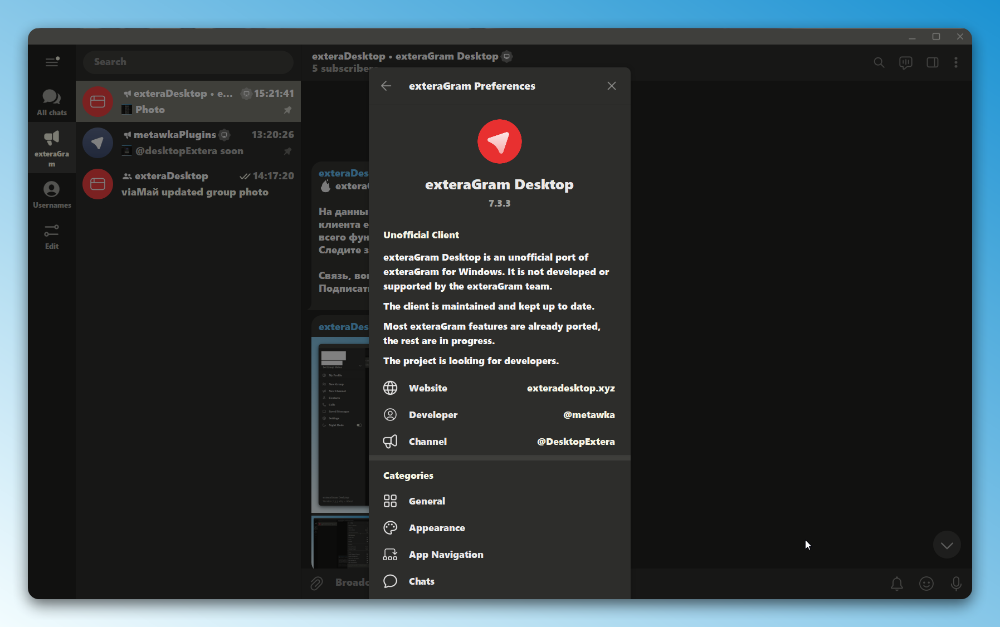
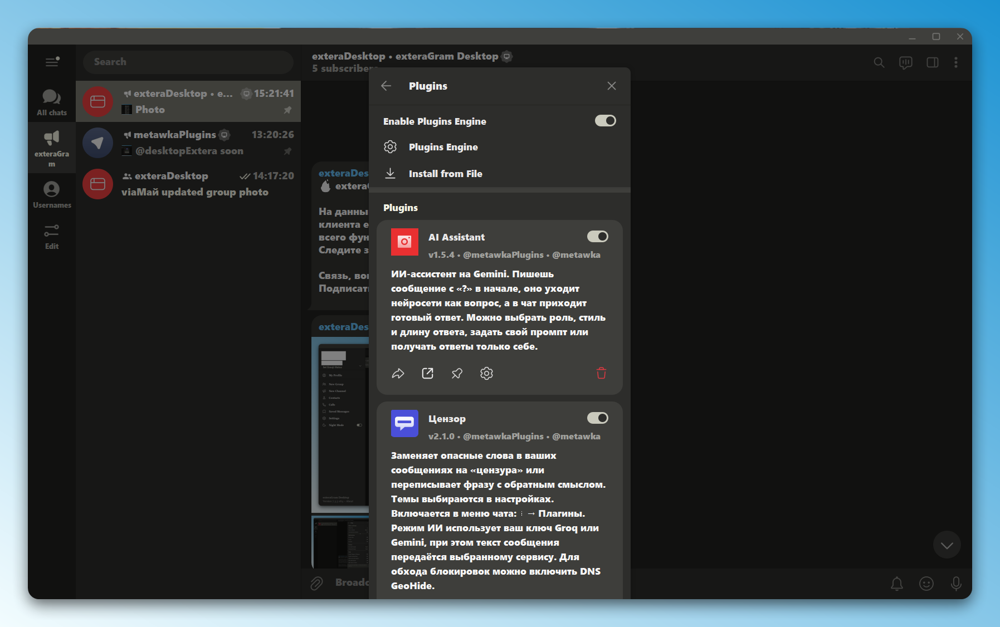

## exteraGram Desktop
*[Licensed under the GNU General Public License v3.0](LICENSE)*

Unofficial **third-party** Windows port of [exteraGram](https://github.com/exteraSquad/exteraGram), based on [official Telegram Desktop sources](https://github.com/telegramdesktop/tdesktop). The exteraGram team does not develop or support this client.

[](https://t.me/DesktopExtera)
[](https://exteradesktop.xyz)
[](https://t.me/metawka)



## Features
- exteraGram Preferences with General, Appearance, Chats, App Navigation, Plugins and Other sections.
- Material Design 3 switches and sliders, avatar corners, 33 app icons from exteraGram.
- Channel feed, wide posts, seconds in message time, edited icon, forward count.
- Streamer mode with per chat type settings and exceptions.
- Python plugins compatible with exteraGram plugins, with automatic safe mode.
- AI chat with Google Gemini using your own API key.
- ID, data center and approximate registration date in profiles.



## Downloads
Ready builds are on the [releases page](https://github.com/metawka/exteraDesktop/releases): an installer and a portable zip. Both include the `python` folder needed for plugins. The client installs beside the official Telegram Desktop and does not conflict with it.

## Importing API hash and keys
- You should get **YOUR OWN API ID AND HASH** here: https://core.telegram.org/api/obtaining_api_id
- Pass them to the configure script when generating the project files:

```
python configure.py x64 -D TDESKTOP_API_ID=123456 -D TDESKTOP_API_HASH=abcdef0123456789abcdef0123456789
```

## Compilation Guide
1. Prepare the build environment by the [official Windows instructions](https://github.com/telegramdesktop/tdesktop/blob/dev/docs/building-win-x64.md) of Telegram Desktop.
2. Put the embedded Python 3.11 runtime into `Libraries/win64/python311`: headers, `python311.lib` and the `embed` folder.
3. Generate the project files with your API ID and hash like [here](#importing-api-hash-and-keys).
4. You are ready to compile `exteraGram Desktop`:

```
cmake --build out --config Release --target Telegram
```

The `python` folder next to `Telegram.exe` is required for plugins.

## exteraGram Desktop Localization
Most strings follow the translations of **Telegram Desktop**. Strings specific to **exteraGram Desktop** are available in English and Russian.

## Thanks to:
- [exteraGram](https://github.com/exteraSquad/exteraGram)
- [Telegram Desktop](https://github.com/telegramdesktop/tdesktop)
- [AyuGram](https://github.com/AyuGram/AyuGramDesktop)
